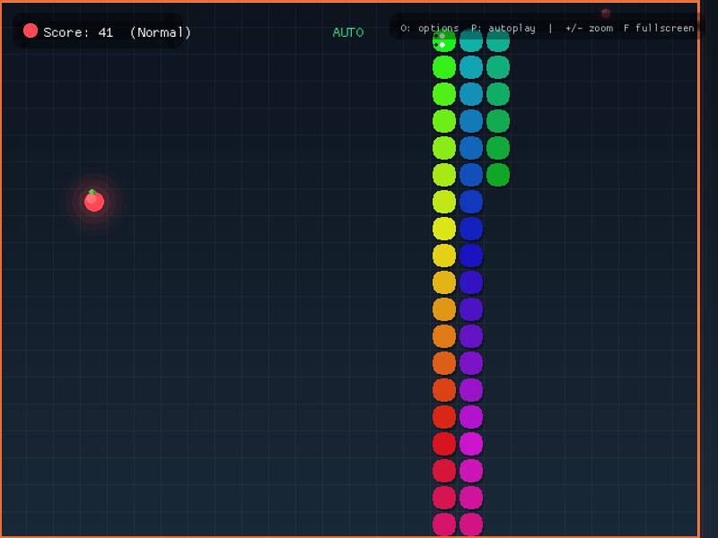

# Snake

A polished take on the classic Snake game, built in Rust with
[macroquad](https://macroquad.rs). Runs on Linux, Windows, and macOS.




## Download

Grab the latest build from the
[Releases](https://github.com/Sadman-Ishtiak/snake/releases) page:

| Platform | File | Run it |
| --- | --- | --- |
| Linux x86_64 | `snake-<version>-linux-x86_64.tar.gz` | Extract, then `./snake` (or `./install-linux.sh`) |
| Linux x86_64 (portable) | `snake-<version>-linux-x86_64.AppImage` | `chmod +x` the file, then run it directly |
| Windows x86_64 | `snake-<version>-windows-x86_64.zip` | Extract, then run `snake.exe` |
| Windows x86_64 (standalone) | `snake-<version>-windows-x86_64.exe` | Run it directly |
| macOS Intel + Apple Silicon | `snake-<version>-macos-universal.zip` | Unzip, drag `Snake.app` to Applications |

The macOS build is a universal binary inside a signed `.app` bundle. It is
ad-hoc signed but not notarized, so the first launch needs **right-click →
Open**, or:

```sh
xattr -dr com.apple.quarantine /Applications/Snake.app
```

The Windows executable is unsigned, so SmartScreen may ask for confirmation on
first launch (**More info → Run anyway**).

The Linux build needs X11 and OpenGL (standard on desktop distributions). The
tarball also contains a desktop entry and icon; run `./install-linux.sh` to
install it for the current user without root.

## Controls

| Key | Action |
| --- | --- |
| `WASD` / arrow keys | Move |
| `Space` | Start / restart / close options |
| `O` | Options menu |
| `P` | Toggle autoplay |
| `+` / `-` | Zoom in / out |
| `F` | Toggle fullscreen |

Options include speed, fruit count, self-collision, solid or wrapping walls,
grid lines, trail effect, and autoplay.

## Build from source

Requires Rust 1.85 or newer (edition 2024):

```sh
cargo run --release
```

To build the optimized binary without running it:

```sh
cargo build --release
# target/release/snake
```

## Create a release

Releases are built and published by
[`.github/workflows/release.yml`](.github/workflows/release.yml) on GitHub
Actions. Each run produces:

- `snake-<version>-linux-x86_64.tar.gz`
- `snake-<version>-linux-x86_64.AppImage`
- `snake-<version>-windows-x86_64.zip`
- `snake-<version>-windows-x86_64.exe`
- `snake-<version>-macos-universal.zip` (x86_64 + aarch64 in one `.app`)

To publish a new version:

1. Update `version` in `Cargo.toml`.
2. Commit and push the change.
3. Tag and push the tag:

   ```sh
   git tag v1.0.0
   git push origin v1.0.0
   ```

The workflow builds every platform, then attaches the archives to a GitHub
release with generated notes. To test the pipeline without publishing, run the
**Release** workflow manually from the Actions tab; the packages are left as
workflow artifacts.

To package locally on Linux:

```sh
./packaging/package-linux.sh
# dist/snake-<version>-linux-x86_64.tar.gz
# dist/snake-<version>-linux-x86_64.AppImage
```

## Regenerate the icon

The icon is generated from code in `packaging/make_icons.py` (requires Pillow):

```sh
python3 packaging/make_icons.py
```

This writes `packaging/snake.png`, `packaging/snake.ico`,
`packaging/snake.icns`, and `src/icon.rs` (the in-game window icon).
